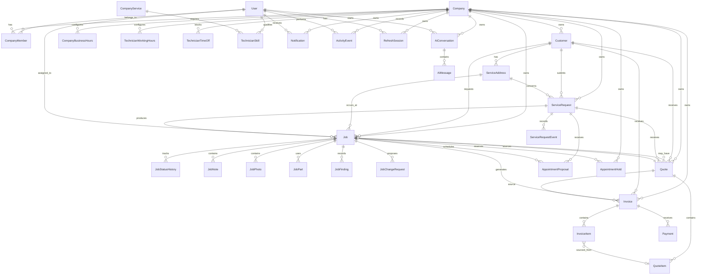

# 04 — Entity Relationship Diagram

## Logical model

## Core entities

### Company
Tenant boundary. All core business data is owned by one company.

### CompanyMember
Join entity linking users to a company and a role.

### Customer
The person/business requesting service.

### ServiceAddress
A customer can have more than one service location.

### Job
The operational center of the product. Contains problem, priority, status, schedule and assignment. New jobs may link to their service request and source quote.

### ServiceRequest
The tenant-scoped intake parent for phone, walk-in, portal and direct-dispatch work. It owns the request state and immutable event trail.

### Booking
`CompanyBusinessHours`, `TechnicianWorkingHours`, `TechnicianTimeOff` and
`TechnicianSkill` provide availability inputs. `AppointmentProposal` stores up
to three customer-facing windows; `AppointmentHold` reserves one window for a
short period before atomic confirmation into a scheduled job.

### Field execution and invoice scope
`JobFinding` stores structured diagnostic results and customer visibility.
`JobChangeRequest` records technician-requested extra work with evidence
references and approval state. `Job.reviewState` gates invoice creation when
company completion review is enabled. `InvoiceItem.sourceType` and `sourceId`
retain whether a line came from an approved quote item, job part,
authorization, or a manual staff line.

### Quote
Commercial proposal attached to customer/job.

### Invoice
Money owed after approved/finished work.

### Payment
Immutable financial event representing money received/recorded.

### ActivityEvent
Audit/operational history. Important actions should be append-only.

### RefreshSession
Server-side control plane for refresh-token rotation/revocation.

### AiConversation / AiMessage
Stores user-facing AI interactions. Never use raw LLM text as an authorization source.

## Cardinality rules

- One user can belong to many companies.
- One company has many members.
- One customer belongs to one company.
- One customer can have many service addresses.
- One job belongs to one company and one customer, and may belong to one service request.
- One job can have zero or one active technician assignment in MVP.
- One quote belongs to one company and may attach to one job and one service request.
- One service request can have many quotes and many jobs.
- One company has many availability rules, proposals and holds; every booking
  record is tenant-scoped.
- A confirmed hold creates at most one scheduled job appointment because
  confirmation rechecks conflicts under a PostgreSQL transaction lock.
- One invoice belongs to one company and can contain many line items.
- One invoice can have many payment events.

## Audit principle

Important state changes are not overwritten without trace. History records preserve who changed what and when.

## v2 entities (Phases 1–8)

- `ServiceRequest` — customer intake record; links to `Job` (many jobs may reference one request; staff-direct jobs get an auto-created request).
- `ServiceRequestMedia` / conversation messages — request attachments and threaded customer↔staff messages.
- `Quote` extended — `serviceRequestId`, `kind`, `basisJobId`, deposit fields (`depositType`, `depositValue`, `depositMinor`), approval reason, expiry/recompute.
- `AppointmentProposal` / `AppointmentHold` — scheduling offers and atomic time holds (CONFIRMED holds resume quote→job creation).
- `CompanyBusinessHours`, `TechnicianWorkingHours`, `TechnicianTimeOff`, `TechnicianSkill` — availability inputs.
- `JobFinding`, `JobChangeRequest`, `Job.reviewState` — field execution and completion review.
- `InvoiceItem.sourceType/sourceId` — provenance (QUOTE_ITEM, JOB_PART, AUTHORIZATION, CREDIT/MANUAL); credit lines may be negative.
- `Payment`, `PaymentSession`, `InvoiceCreditApplication`, `Refund`, `PaymentDispute` — money movement; integer minor units only.
- `ProviderWebhookEvent` — deduplicated webhook inbox.
- `JobTrackingState` — one row per job, last position only (no history), wiped on arrival/cancel/reassign/complete.
- `NotificationOutbox` — durable at-least-once delivery with dedupeKey, backoff, dead-letter.
- `PortalDeliveryToken` — send-time-minted single-use token hashes for outbox-delivered portal links; plaintext never persisted.
- `PortalAccessGrant` / `PortalSession` / `PortalAuditEvent` — workspace access, sessions, audit.
