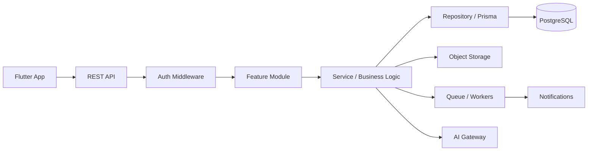

# Aera — Architecture

> This is the single source of truth for runtime architecture, backend boundaries, API conventions, deployment shape, and architecture decisions.


## 1. Architecture goal

Use a modular monolith first: one deployable backend, strict internal modules, one PostgreSQL database. This avoids premature microservices while keeping boundaries clear enough to extract services later.

## 2. Technology decisions

### Mobile
- Flutter/Dart.
- Riverpod for application state.
- go_router for navigation.
- Dio or `http` for REST calls.
- Local persistence for cached/session data and future sync queue.
- Image compression before upload.

### Backend
- Node.js LTS.
- TypeScript with strict mode.
- Express 5.
- Zod for request/response validation.
- Prisma ORM.
- Pino structured logging.
- OpenTelemetry-compatible tracing later.
- JWT access tokens.
- Rotating refresh-token sessions.

### Database
- PostgreSQL.
- UUID identifiers.
- UTC timestamps.
- Integer minor units for money.
- PostgreSQL constraints + application invariants.

### Object storage
- S3-compatible object storage or Supabase Storage.
- Database stores metadata and object keys, not image binary data.

### Async jobs
Start with a queue abstraction. Add Redis/BullMQ when background load requires it.

Use background jobs for:
- notifications,
- image processing,
- email/SMS,
- AI summarization,
- scheduled invoice reminders.

Do not make the primary request wait for non-critical side effects.

## 3. High-level flow



## 4. Backend module structure

```text
backend/
  src/
    app.ts
    server.ts
    config/
    common/
      errors/
      http/
      logging/
      auth/
      pagination/
      validation/
    modules/
      auth/
      companies/
      members/
      customers/
      jobs/
      scheduling/
      quotes/
      invoices/
      payments/
      files/
      notifications/
      activity/
      ai/
    db/
      prisma.ts
    routes/
    workers/
  prisma/
    schema.prisma
    migrations/
  tests/
```

Each feature module should be internally organized around:

```text
route → controller → service → repository → database
                    ↘ integrations
```

Controllers should be thin. Business rules live in services/domain logic, not HTTP handlers.

## 5. Multi-tenancy model

Every request resolves:

```text
access token
  ↓
user id
  ↓
company membership
  ↓
role
  ↓
company id
```

Services must require `companyId` explicitly. Repositories must scope queries by `companyId` unless the operation is truly global.

Never trust a `companyId` supplied by the Flutter client.

## 6. Authentication

Access token:
- Short-lived.
- Contains user/session identity, not sensitive business data.

Refresh token:
- Long-lived.
- Stored server-side as a hash/identifier so sessions can be revoked.
- Rotated on use.

Security:
- Rate-limit login.
- Generic credential error messages.
- Revoke refresh session on suspicious reuse.

## 7. Authorization

Use RBAC plus ownership/assignment checks.

Example:

```text
owner
  → all company resources

dispatcher
  → customers, jobs, schedule, quotes, invoices
  → cannot modify company security/billing settings unless granted

technician
  → assigned jobs
  → own execution records
  → limited customer data
```

Authorization must be evaluated against the database record, not only a role string from the client.

## 8. Job state machine

```text
NEW
 ↓
QUOTING ──→ SCHEDULED
              ↓
           EN_ROUTE
              ↓
         IN_PROGRESS
          ↙       ↘
WAITING_PARTS    COMPLETED
    ↓
IN_PROGRESS

Any active state → CANCELLED (subject to permission)
```

Every transition records actor, timestamp, previous state, new state, and optional reason.

## 9. Transaction boundaries

Use database transactions when one business action spans multiple writes.

Examples:

- quote approval + job activation;
- job completion + invoice creation;
- payment record + invoice balance update;
- company creation + owner membership;
- invite acceptance + membership creation.

The unit must commit together or roll back together. Prisma documents this transaction pattern, and PostgreSQL provides defined transaction isolation behavior. citehttps://www.prisma.io/docs/orm/prisma-client/queries/transactionshttps://www.postgresql.org/docs/current/transaction-iso.html

## 10. API versioning

Base path:

```text
/api/v1
```

Envelope:

```json
{
  "data": {},
  "meta": {}
}
```

Errors:

```json
{
  "error": {
    "code": "JOB_NOT_FOUND",
    "message": "Job not found"
  },
  "requestId": "..."
}
```

## 11. Deployment shape

Portfolio deployment:

```text
Flutter APK / TestFlight
        ↓
HTTPS
        ↓
Node API service
        ↓
Managed PostgreSQL
        ↓
Object storage
```

Production evolution:

```text
CDN / WAF
   ↓
API instances
   ↓
PostgreSQL + connection pooling
   ↓
Redis/queue
   ↓
workers
```

## 12. Architecture rules

- No SQL/database calls from Flutter.
- No business logic in UI widgets.
- No direct Prisma calls from controllers.
- No unvalidated request body.
- No cross-tenant query without explicit authorization.
- No hidden global mutable state.
- No network call in a tight Flutter build loop.
- No synchronous waiting for non-critical notifications/AI work.

---

# API Contract


## 1. Base URL

```text
/api/v1
```

## 2. Authentication endpoints

```text
POST   /auth/register
POST   /auth/login
POST   /auth/refresh
POST   /auth/logout
GET    /auth/me
```

## 3. Company/team

```text
POST   /companies
GET    /companies/:companyId
GET    /companies/:companyId/members
POST   /companies/:companyId/invitations
PATCH  /companies/:companyId/members/:memberId
DELETE /companies/:companyId/members/:memberId
```

The client should not choose an arbitrary tenant context. Company access is derived from authenticated membership and validated server-side.

## 4. Customers

```text
GET    /customers
POST   /customers
GET    /customers/:customerId
PATCH  /customers/:customerId
DELETE /customers/:customerId
GET    /customers/:customerId/jobs
```

Supported query patterns:

```text
?page=1&pageSize=20&search=sarah&status=ACTIVE
```

Use cursor pagination later for very large histories.

## 5. Jobs

```text
GET    /jobs
POST   /jobs
GET    /jobs/:jobId
PATCH  /jobs/:jobId
POST   /jobs/:jobId/assign
POST   /jobs/:jobId/status
POST   /jobs/:jobId/notes
POST   /jobs/:jobId/photos/presign
POST   /jobs/:jobId/complete
GET    /jobs/:jobId/history
```

Status mutation should be an explicit command rather than allowing clients to patch arbitrary status fields.

## 6. Scheduling

```text
GET    /schedule?date=YYYY-MM-DD
POST   /jobs/:jobId/schedule
POST   /jobs/:jobId/reschedule
```

Booking is an additive, feature-gated surface. `BOOKING_ENABLED=false` leaves
the legacy schedule contract unchanged.

```text
GET    /booking/config
PATCH  /booking/config
GET    /booking/queue
GET    /booking/availability
POST   /booking/proposals
POST   /booking/proposals/:proposalId/pick
POST   /booking/holds
POST   /booking/holds/:holdId/confirm
```

Availability is calculated as technician capacity from server-owned working
hours, time off, existing jobs, active holds and travel buffers. Holds expire
after ten minutes. Confirmation takes a per-company-day PostgreSQL advisory
transaction lock, rechecks conflicts, and updates the job and hold atomically.
The pure capacity engine accepts instants from the API boundary and never
performs database reads.

## 7. Quotes

```text
POST   /quotes
GET    /quotes
GET    /quotes/:quoteId
POST   /quotes/:quoteId/send
GET    /quotes/shared/:shareToken
POST   /quotes/shared/:shareToken/respond
```

Quote creation calculates line totals, tax, discount, and total server-side.
Shared responses are customer-facing and create immutable approval events. An
approved quote remains attached to its existing job; scheduling continues that
job rather than creating a duplicate record.

## 8. Invoices/payments

```text
GET    /invoices
GET    /invoices/:invoiceId
POST   /invoices/from-job/:jobId
POST   /invoices/:invoiceId/issue
POST   /invoices/:invoiceId/payments
GET    /invoices/:invoiceId/payments
```

Payment mutations require an `Idempotency-Key` header. Invoice generation is
unique per company/job, and payment recording rejects amounts above the current
balance inside the same transaction that updates invoice state.

## 9. Customer portal

```text
POST /customers/:customerId/portal-access        (staff: issue workspace link)
POST /portal/exchange                            (single-use link → session)
GET  /portal/me | /requests | /quotes | /jobs | /invoices   (workspace reads)
GET  /portal/job                                 (legacy JOB-scope snapshot)
```

Portal links are exchanged once for a session scoped to either a single job
(legacy JOB grant) or a whole customer workspace within one company
(WORKSPACE grant). The workspace surface ships behind
`WORKSPACE_PORTAL_ENABLED` and is off by default until its release gate.
Sessions expose only the session customer's own records; cross-tenant and
cross-customer reads return 404. Legacy `CustomerPortalToken` rows and
`Quote.shareToken` are deprecated (ADR-020) and must not be read by new code.

## 9. Dashboard

```text
GET /dashboard/summary
GET /dashboard/today
GET /dashboard/alerts
```

Do not create a giant dashboard endpoint returning the entire database. Query only the data the screen actually needs.

## 10. AI

```text
POST /ai/conversations
GET  /ai/conversations
GET  /ai/conversations/:conversationId
POST /ai/conversations/:conversationId/messages
```

AI server architecture:

```text
Flutter
  ↓
POST message
  ↓
AI service
  ↓
authorized tools
  ↓
scoped application services
  ↓
PostgreSQL
```

The model never receives raw database credentials.

## 11. Error taxonomy

Examples:

```text
AUTH_INVALID_CREDENTIALS
AUTH_SESSION_EXPIRED
AUTH_FORBIDDEN
TENANT_ACCESS_DENIED
RESOURCE_NOT_FOUND
VALIDATION_FAILED
JOB_INVALID_STATUS_TRANSITION
QUOTE_ALREADY_DECIDED
INVOICE_ALREADY_VOID
PAYMENT_DUPLICATE
RATE_LIMITED
INTERNAL_ERROR
```

## 12. Idempotency

For retry-sensitive writes:

```http
Idempotency-Key: 6f4c...
```

Server stores the key and resulting operation state for an appropriate retention period.

Especially important for:
- payment recording;
- invoice issuing;
- customer-visible message sending;
- job completion if completion triggers invoice creation.

---

# Architecture Decision Records

## ADR-018 — Booking is additive and server-authoritative

**Context:** Existing companies use the legacy schedule endpoints, while Phase
5 needs proposals, holds and customer-selectable windows.

**Decision:** Add `/booking` behind `BOOKING_ENABLED`, retain `/schedule`
unchanged, and make availability, conflict checks and booking mode decisions
server-authoritative. The default mode is `DISPATCHER_CONFIRMS`.

**Rejected alternatives:** Replacing the existing schedule API would risk
breaking dispatch workflows; client-side conflict checks cannot guarantee
correctness under concurrent confirmation.

**Consequences:** New booking tables can be deployed additively and enabled
per environment. Confirmation is serialized by company and local calendar day.

**Revisit trigger:** Replace the in-process expiry sweep with a durable worker
when booking volume or multi-instance scheduling requires it.


## ADR-001 — Modular monolith first

**Decision:** Use one Node.js backend deployable as one service, internally divided into modules.

**Why:** The product is early-stage and needs speed of development, clear ownership of business rules, and low operational complexity. Microservices would add networking, deployment, observability, and consistency problems before the product needs them.

**Revisit when:** separate scaling/security/deployment requirements are demonstrated by measurements or organizational needs.

## ADR-002 — PostgreSQL over document database

**Decision:** PostgreSQL.

**Why:** Jobs, customers, schedules, quotes, invoices, payments, memberships, and audit history are relational and transaction-heavy. Strong constraints and transactional semantics are valuable.

## ADR-003 — Prisma as ORM

**Decision:** Prisma.

**Why:** Strong TypeScript developer experience, migrations, schema-first workflow and transaction support. Keep SQL knowledge as part of engineering competence; the ORM is not a replacement for database reasoning.

## ADR-004 — REST API

**Decision:** Versioned REST under `/api/v1`.

**Why:** Easy to inspect, debug, document and integrate with Flutter and future web/admin clients. GraphQL is unnecessary for the first product version.

## ADR-005 — JWT access + server-controlled refresh sessions

**Decision:** Short-lived access tokens plus revocable rotating refresh sessions.

**Why:** Mobile clients need persistent sessions while the company needs session revocation and security controls.

## ADR-006 — Server-authoritative business rules

**Decision:** Flutter is never authoritative for money, permissions, workflow transitions, or tenant scope.

**Why:** Clients can be modified, intercepted or out of date. Server-side invariants protect the business.

## ADR-007 — Integer minor-unit money

**Decision:** Store money as integer minor units and an explicit ISO-like currency code.

**Why:** Avoid floating-point rounding problems in billing logic.

## ADR-008 — Object storage for photos

**Decision:** Store photos outside PostgreSQL; store metadata/object keys in PostgreSQL.

**Why:** Keeps relational data compact and allows storage/CDN optimization.

## ADR-009 — Async side effects

**Decision:** Notifications, AI enrichment, and other slow secondary work should use an async abstraction.

**Why:** Primary user actions should not fail because a notification provider is temporarily unavailable.

Notification delivery uses a channel-aware outbox when `NOTIFICATION_OUTBOX_ENABLED`
is enabled. Each recipient and channel (in-app, email, push, and SMS) has its own
dedupe key, retry state, and provider outcome, so a failed provider cannot block
the other channels or the business transaction. The outbox worker re-checks
active company membership before delivery and treats provider failures as
background errors.

## ADR-010 — AI is a tool caller, not an authority

**Decision:** AI may read data only through authorized tools and may never receive direct database access. Sensitive mutations require explicit typed commands with authorization.

**Why:** Prevents prompt injection and model output from becoming an authorization mechanism.

## ADR-011 — Service requests precede operational jobs

**Context:** Work can begin from phone intake, a customer request, an inspection, or a direct staff dispatch.

**Decision:** `ServiceRequest` is the parent intake record. Quotes and jobs may attach to it, while direct staff jobs create an accepted `STAFF_DIRECT` request in the same transaction.

**Rejected:** Making Job the intake record would conflate a request, a quote and booked work.

**Consequence:** Request status is independently auditable and job existence is derived from related jobs.

**Revisit when:** A future workflow needs a separate intake aggregate.

## ADR-012 — Request state machine and inspection flag

**Decision:** Service requests use explicit SUBMITTED, NEEDS_INFO, QUOTING, QUOTED, ACCEPTED, DECLINED, EXPIRED, CANCELLED and CLOSED states. `requiresInspection` is a boolean, not a state.

**Why:** Inspection is a routing requirement and must not create a second state machine.

**Revisit when:** Inspection develops independent lifecycle requirements.

## ADR-013 — Request, quote and job cardinality

**Decision:** One request can have many quotes and jobs. `Quote.jobId` remains the job advanced or changed by that quote; `basisJobId` identifies an informational diagnostic basis.

**Consequence:** Revisions and diagnostic-to-repair flows do not overwrite history.

## ADR-014 — Immutable sent quotes and revision chains

**Decision:** A sent quote is immutable. Revisions create a new quote linked by `supersedesQuoteId`; totals are recomputed server-side.

**Revisit when:** A versioned commercial-document subsystem replaces the current quote model.

## ADR-015 — Separate deposit invoice and explicit credits

**Decision:** Deposits are separate invoices and later credits are explicit invoice-credit rows. Payments remain immutable.

**Rejected:** Loosening Payment-to-Invoice ownership or editing payment records.

## ADR-016 — Workspace scope is customer/company based

**Decision:** A workspace grant authenticates one customer relationship within one company. Legacy job-scoped portal grants remain isolated until deprecation.

**Revisit when:** Multi-contact or property-manager accounts are introduced.

## ADR-017 — Completion review is a field, not a job status

**Decision:** Keep the existing eight job statuses and represent review with `reviewState`. This preserves existing scheduling, dashboard and portal behavior.

**Revisit when:** Completion review needs independent scheduling semantics.

## ADR-018 — Verified arrival is derived from the handshake

**Decision:** The customer handshake timestamp is exposed as `arrivedVerifiedAt`; no ARRIVED status is added to the job state machine.

**Why:** Arrival is a verified fact used by staff, technicians and customers, while the existing eight-state workflow remains stable.

**Revisit when:** Arrival needs a separate operational workflow with independent transitions.

## ADR-019 — Invoice lines retain their approved scope source

**Decision:** Final invoice items store a nullable source type and source id. Approved quote items and job parts are distinguishable from manual lines, and invoice generation remains behind the existing completion and review gates.

**Why:** Server-side provenance prevents unapproved field work from silently becoming customer charges while preserving the current manual-payment pipeline.

**Revisit when:** Change-order authorization becomes a separate financial aggregate in the payments phase.

## ADR-020 — Legacy portal tokens are deprecated, not removed

**Decision:** `CustomerPortalToken` and `Quote.shareToken` are deprecated in favour of `PortalAccessGrant` link tokens exchanged for `PortalSession`s. Existing rows and live job-scoped links keep working unchanged; staff may still issue job links until the workspace rollout gate. No new code may read the deprecated fields.

**Why:** Removing them would break live customer links; keeping both paths indefinitely would split the authorization surface.

**Revisit when:** All legacy job links have expired and usage telemetry shows zero reads of the deprecated fields.

## Architecture ownership

This file owns system boundaries, technology choices, module structure, tenancy and authorization architecture, job-state architecture, transactions, REST API conventions, deployment, and ADRs. Coding standards and verification gates belong in `rules.md`.

## v2 architecture (Phases 1–8)

- Lifecycle is backend-authoritative: `request → quote → job → invoice → payment`. Clients never supply totals, authorization decisions, or lifecycle transitions the server can derive.
- Money is integer minor units (BigInt at the DB edge, serialized safely in DTOs); invoices recompute totals from line items at issue time.
- Quote acceptance runs pluggable gates (`QUOTE_ACCEPTANCE_GATES`): `DepositGate` blocks job creation until the deposit invoice is paid; `BookingGate` enforces the company booking mode.
- Scheduling uses an availability engine expanding wall-clock hours in `company.timezone`, advisory-lock-serialized hold confirmation, and idempotent job creation via `sourceQuoteId`.
- Notifications are durable: `notificationPublisher` enqueues `NotificationOutbox` rows when `NOTIFICATION_OUTBOX_ENABLED`; a queue worker claims batches with conditional updates, applies exponential backoff, and dead-letters after max attempts. Portal links are minted at send time via `PortalDeliveryToken` — no plaintext token is persisted.
- Tracking is polling-based (no WebSockets): technicians POST positions to a rate-limited endpoint only while EN_ROUTE; customers poll `GET /portal/jobs/:id/tracking`, which returns coordinates only when fresh (<2 min) and audits every read.
- Payments go through a provider port (sandbox adapter shipped; production provider is owner decision D-1) with HMAC webhook verification, timestamp/replay checks, and a deduplicated `ProviderWebhookEvent` inbox.
- Rollout is flag-ordered (`REQUESTS_ENABLED`, `WORKSPACE_PORTAL_ENABLED`, `QUOTE_BEFORE_JOB_ENABLED`, `BOOKING_ENABLED`, `COMPLETION_REVIEW_ENABLED`, `INVOICE_FROM_SCOPE_ENABLED`, `ONLINE_PAYMENTS_ENABLED`, `LIVE_TRACKING_ENABLED`, `NOTIFICATION_OUTBOX_ENABLED`); rollback is flag-off since the schema is additive. See `docs/phase_8_release_runbook.md`.
